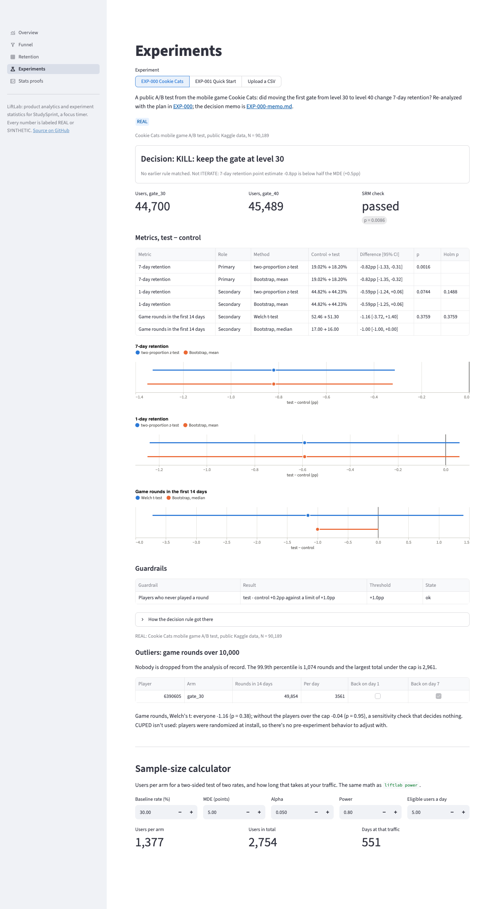

# LiftLab

LiftLab is a growth-analytics project built around a small, real product. StudySprint is a focus timer for students: it runs on GitHub Pages and sends anonymous events to PostHog. Around it sits what a growth team would use to improve it: a North Star and metric tree, a tracking plan, a DuckDB warehouse with SQL funnels and retention, pre-registered A/B tests behind feature flags, and a Python stats library (SRM checks, bootstrap, CUPED, sequential testing) that's also used to re-analyze the public Cookie Cats A/B test. It all runs on free tiers.

**Try it:** [singha105.github.io/liftlab](https://singha105.github.io/liftlab/). Add [`?demo=1`](https://singha105.github.io/liftlab/?demo=1) to run every timer in seconds instead of minutes.

## Privacy

StudySprint sends anonymous usage analytics only: no account, no names or emails, nothing you type, no session recording, no IP addresses. Do Not Track and Global Privacy Control are respected (PostHog isn't even loaded), and the footer has a switch to turn analytics off. Exactly which events are sent is listed in the [tracking plan](docs/TRACKING_PLAN.md), and a test fails if the code and that list disagree.

## Layout

```
liftlab/
├── app/            StudySprint: Vite + TypeScript, deployed to GitHub Pages
├── analysis/       Python package `liftlab`: simulator, DuckDB warehouse, stats library, tests
│   ├── dashboard.py        the Streamlit dashboard; its pages are in dashboard_pages/
│   ├── sql/        the seven SQL models, built in order by `liftlab build`
│   └── src/liftlab/
│       ├── stats/      SRM, z and Welch tests, delta method, bootstrap, CUPED, mSPRT, Holm, power
│       ├── readout.py  runs a pre-registered analysis plan and its decision rule
│       ├── monitor.py  the weekly SRM and guardrail checks while a test runs
│       ├── cookie_cats.py  the Cookie Cats re-analysis, EXP-000
│       └── proofs.py   the stats library on thousands of simulated experiments
├── data/           local only, gitignored: raw downloads, event exports, DuckDB files
│   └── raw/
├── docs/
│   ├── PRODUCT_BRIEF.md       who it's for, core loop, v1 scope
│   ├── METRICS.md             North Star, metric tree, exact definitions
│   ├── TRACKING_PLAN.md       every event, its properties, privacy rules
│   ├── EXPERIMENT_BACKLOG.md  ICE-ranked hypotheses
│   ├── ANALYTICS.md           the warehouse, the models, the simulator and its ground truth
│   ├── STATS.md               every statistical method, its formula and how it's checked
│   ├── img/                   charts for the docs
│   ├── experiments/           pre-registrations and PostHog setup, one per experiment
│   ├── decisions/             decision records
│   └── PROGRESS.md            day-by-day log
├── .streamlit/     the dashboard's theme (Streamlit reads it from the repo root)
├── .github/workflows/
│   ├── deploy-app.yml   test, build and deploy app/ to Pages
│   └── analysis.yml     ruff and pytest for analysis/ on every push
├── .env.example    PostHog settings for event export (copy to .env)
└── LICENSE         MIT
```

## Running it

The app needs Node 20.19+ or 22.12+:

```bash
cd app && npm install && npm run dev
```

```bash
cd app && npm test
```

Analytics stay off locally unless you copy `app/.env.example` to `app/.env.local` and add a PostHog project key. The deployed build gets `VITE_POSTHOG_KEY` and `VITE_POSTHOG_HOST` from repository variables in [the deploy workflow](.github/workflows/deploy-app.yml).

The analysis package needs [uv](https://docs.astral.sh/uv/). This simulates 20,000 users, loads them into DuckDB, builds the funnel, retention and North Star models, and prints them:

```bash
cd analysis && uv run liftlab load --source synthetic && uv run liftlab build && uv run liftlab report
```

```bash
cd analysis && uv run pytest
```

The numbers it prints are **synthetic**: simulated users with known ground truth, used to check that the SQL measures what it should. [ANALYTICS.md](docs/ANALYTICS.md) explains the models, the simulator and how to pull real events from PostHog.

Planning an experiment, and checking the plan against simulated experiments with a known effect:

```bash
cd analysis && uv run liftlab power --baseline 0.30 --mde 0.05 --daily 5 10 40
```

```bash
cd analysis && uv run liftlab dry-run --reps 200
```

Reading an experiment: the pre-registered readout (SRM, primary, guardrails, secondaries, then the decision rule), and the weekly checks while it runs. Both read from the warehouse, so load and build first:

```bash
cd analysis && uv run liftlab readout --source posthog
```

```bash
cd analysis && uv run liftlab monitor --source posthog
```

The stats library is checked on thousands of simulated experiments where the truth is known. It takes up to an hour on 8 cores and redraws the charts in [docs/STATS.md](docs/STATS.md):

```bash
cd analysis && uv run liftlab proofs
```

Reading an experiment before it reaches its planned N. `--interim` gives the read so far at any N, with the power it has and the smallest effect it could detect, and decides nothing ([EXP-001's Amendment 2](docs/experiments/EXP-001.md)):

```bash
cd analysis && uv run liftlab readout --source posthog --interim
```

The library's first real data is the public [Cookie Cats A/B test](https://www.kaggle.com/datasets/yufengsui/mobile-games-ab-testing): 90,189 players of a mobile game, with the first gate at level 30 or level 40. Save the Kaggle CSV as `data/raw/cookie_cats.csv` (it's gitignored and never committed), then:

```bash
cd analysis && uv run liftlab cookie-cats
```

The plan is [EXP-000](docs/experiments/EXP-000-cookie-cats.md), written after the data existed and labeled as such, and the decision is in [the memo](docs/experiments/EXP-000-memo.md): keep the gate at level 30.

The running experiment is [EXP-001, Quick Start](docs/experiments/EXP-001.md), behind the PostHog flag `exp-001`. To see its test arm without being enrolled, open [`?demo=1&variant=test`](https://singha105.github.io/liftlab/?demo=1&variant=test) in a private window.

## Dashboard

Five pages: Overview (the North Star, its inputs and guardrails, the metric tree), Funnel, Retention, Experiments (EXP-000, EXP-001, or any CSV you upload, plus a sample-size calculator) and Stats proofs. Every page has a REAL or SYNTHETIC badge. Run it from the repo root, so Streamlit finds `.streamlit/config.toml`:

```bash
uv run --project analysis streamlit run analysis/dashboard.py
```

It needs no secrets and no local data. Without a warehouse it builds the synthetic run (a few seconds), and without the Cookie Cats CSV it shows the saved EXP-000 readout and offers an upload to recompute it. StudySprint's own pages switch to REAL once `liftlab export-posthog` has loaded live events.

<picture>
  <source media="(prefers-color-scheme: dark)" srcset="docs/img/dashboard-experiments-dark.png">
  
</picture>

More screenshots: [Overview](docs/img/dashboard-overview.png), [Funnel](docs/img/dashboard-funnel.png), [Retention](docs/img/dashboard-retention.png), [Stats proofs](docs/img/dashboard-proofs.png).

### Deploying to Streamlit Community Cloud

It's free for a public repo and needs no secrets:

1. At [share.streamlit.io](https://share.streamlit.io), sign in with GitHub and create an app from an existing repo.
2. Repository `singha105/liftlab`, branch `main`, main file path `analysis/dashboard.py`.
3. Under Advanced settings, pick Python 3.12 and leave Secrets empty.
4. Deploy.

Community Cloud installs from `analysis/uv.lock`, since it looks next to the main file first and prefers `uv.lock` to `requirements.txt`, and it reads `.streamlit/config.toml` from the repo root. The deployed app has no warehouse, so StudySprint's pages show the synthetic run.

## Status

Day 6 of 7: the library has read its first real A/B test (Cookie Cats: keep the gate at level 30), EXP-001 has an interim read, and the dashboard shows all of it. EXP-001 is still waiting on the PostHog key. See [docs/PROGRESS.md](docs/PROGRESS.md).

## License

[MIT](LICENSE)
