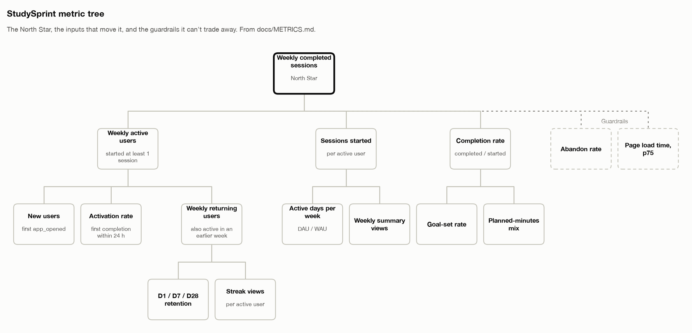
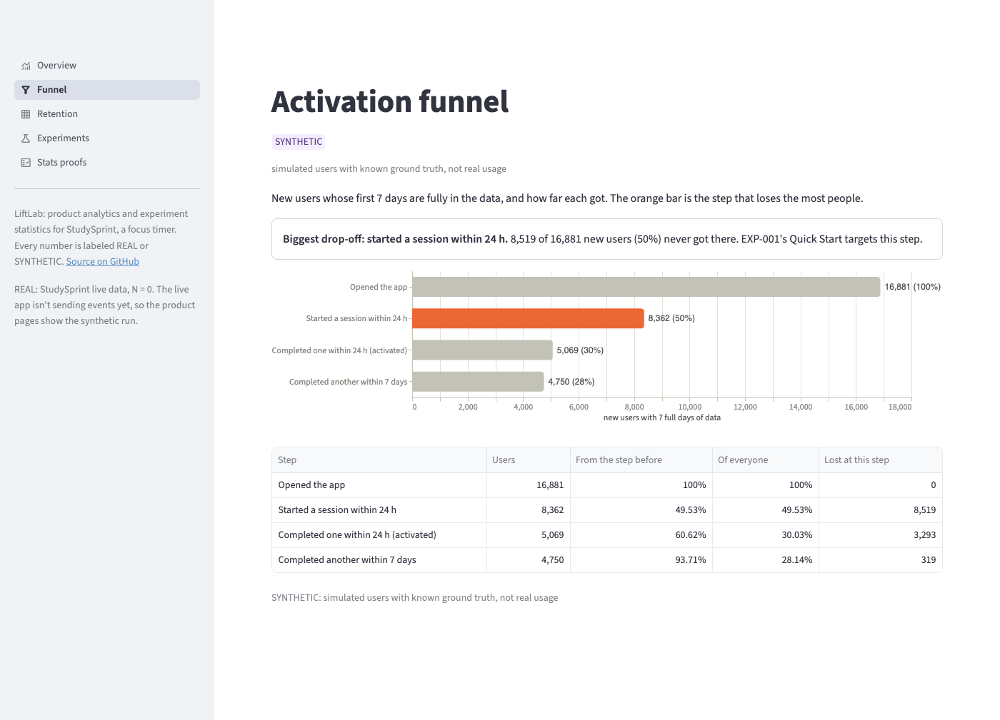
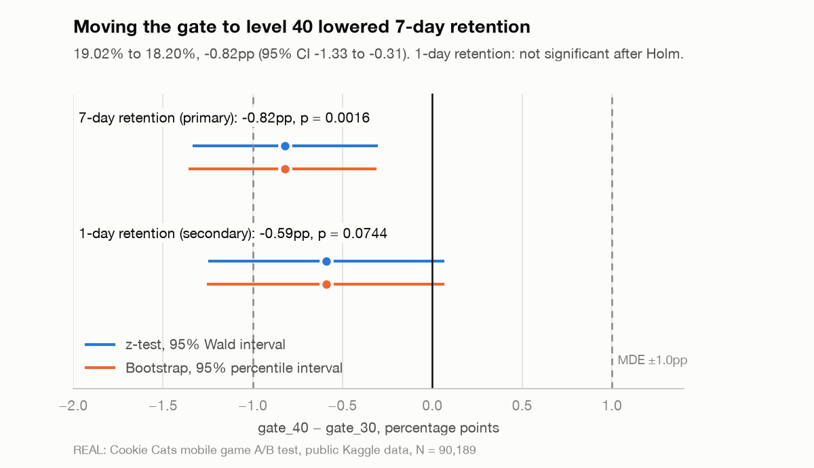
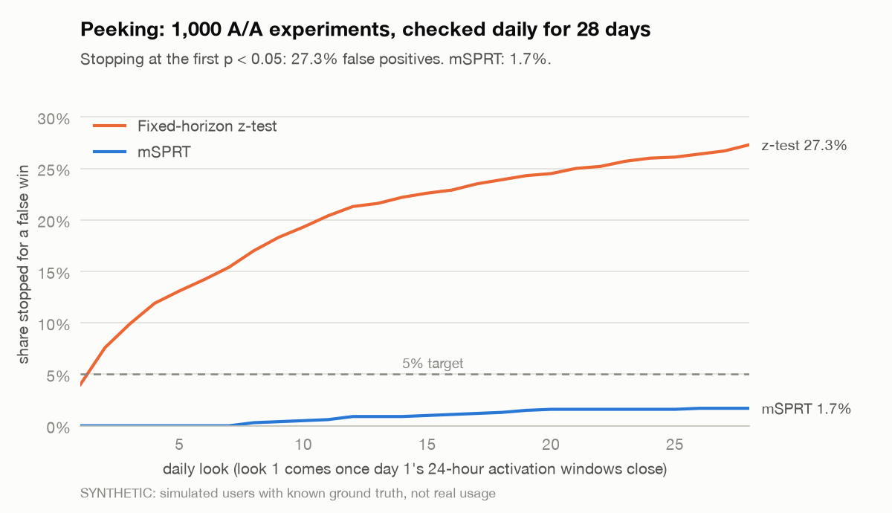
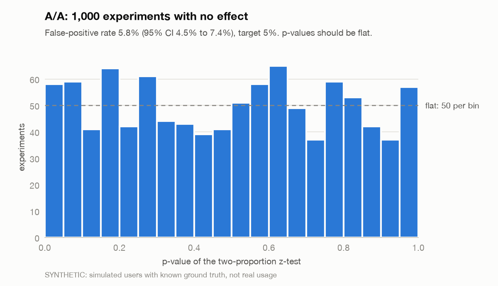
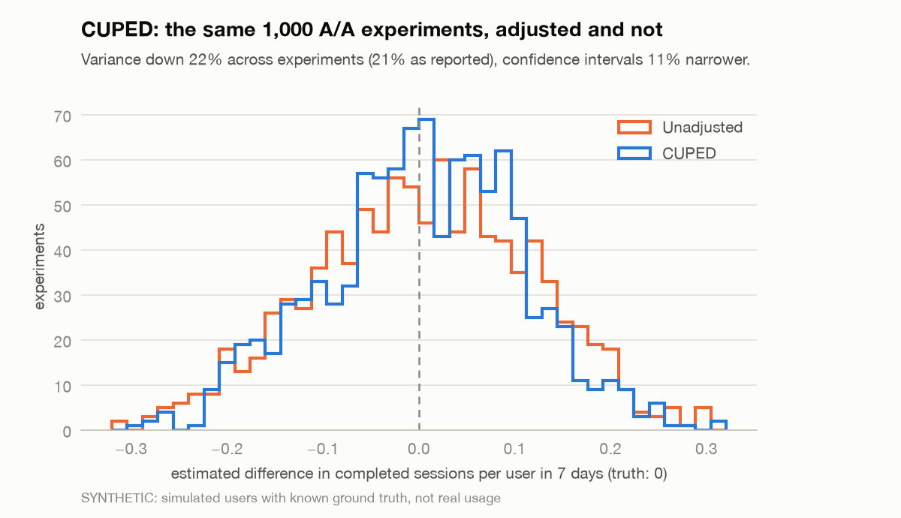
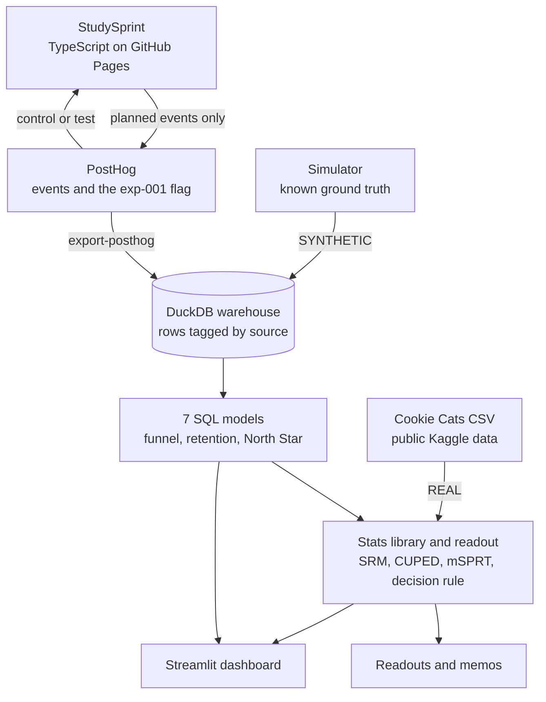

# LiftLab

[](https://github.com/singha105/liftlab/actions/workflows/ci.yml)
[](https://github.com/singha105/liftlab/actions/workflows/deploy-app.yml)
[](https://github.com/singha105/liftlab/releases)
[](LICENSE)

**One small product taken from discovery to decision with data: a shipped study timer, its North Star and tracking, pre-registered A/B tests, a stats library checked against known answers, and a real keep-or-ship call on a public A/B test. All on free tiers, at $0.**

[Live StudySprint](https://singha105.github.io/liftlab/) · Dashboard screenshots: [Overview](docs/img/dashboard-overview.png), [Funnel](docs/img/dashboard-funnel.png), [Retention](docs/img/dashboard-retention.png), [Experiments](docs/img/dashboard-experiments.png), [Stats proofs](docs/img/dashboard-proofs.png) · Decision memos: [EXP-000 Cookie Cats](docs/experiments/EXP-000-memo.md), [EXP-001 Quick Start](docs/experiments/EXP-001-interim.md)

Every number below is labeled. **REAL** means real people: the public Cookie Cats test, or StudySprint's live users (none yet). **SYNTHETIC** means simulated users with known ground truth, not real usage.

## In 90 seconds

- **Shipped [StudySprint](https://singha105.github.io/liftlab/)**, a focus timer for students, in vanilla TypeScript on GitHub Pages: 6.2 kB of gzipped JavaScript, anonymous PostHog analytics with the privacy rules enforced in code, and a typed tracking plan the build checks.
- **Chose a North Star** (weekly completed sessions) and a metric tree, then built the funnel and D1/D7/D28 retention in DuckDB SQL, checked against a simulator's ground truth: activation 29.95% against a true 30.69% on one seed, and exactly 30.69% averaged over six (SYNTHETIC).
- **Pre-registered a Quick Start A/B test** behind a feature flag before writing the variant, and found before launch that it needs 1,377 users per arm: 551 days at StudySprint's traffic. So the live run proves the plumbing, and the statistics are validated where the answer is known.
- **Built and proved an experiment library**: on 1,000 simulated A/A tests peeked at daily for 28 days, a fixed-horizon z-test declared a false win 27.3% of the time and the mSPRT 1.7%; CUPED cut variance 22% (SYNTHETIC).
- **Made a real call on a public A/B test.** Cookie Cats, 90,189 players: moving the first gate from level 30 to level 40 lowered 7-day retention by 0.82 points (95% CI −1.33 to −0.31), so the recommendation is to keep it at level 30 (REAL).

## The product and its North Star

StudySprint is for a university student who has time to study but can't get started. Pick 15, 25 or 50 minutes, optionally tap what you're working on, and focus until the timer ends. Finishing a session grows your streak, and a weekly summary shows what you got done. There's no account and no backend; everything lives in the browser. ([Product brief](docs/PRODUCT_BRIEF.md))

The North Star is **weekly completed sessions**: focus sessions that ran to the end. A completed session is the unit of value, it leads retention through the streak, and it splits exactly into weekly active users × sessions per active user × completion rate, so every experiment can name the input it moves. Weekly active users was rejected as a vanity metric, and weekly focus minutes rewards long sessions over follow-through. ([ADR 0001](docs/decisions/0001-north-star.md), [METRICS.md](docs/METRICS.md))

<picture>
  <source media="(prefers-color-scheme: dark)" srcset="docs/img/metric-tree-dark.png">
  
</picture>

**Privacy.** StudySprint sends only the events in the [tracking plan](docs/TRACKING_PLAN.md): no names or emails, nothing typed, no session recording, no autocapture. Do Not Track and Global Privacy Control mean PostHog isn't even downloaded, and the footer has a switch to turn analytics off. A test fails if the code and the tracking plan disagree. ([ADR 0002](docs/decisions/0002-privacy-by-default.md))

## What the data showed

StudySprint started sending events to PostHog on 2026-11-01 and has no real users yet: **REAL: StudySprint live data, N = 0.** The product numbers come from the simulator (seed 7, 20,000 users), whose behavior is built from the [experiment backlog's](docs/EXPERIMENT_BACKLOG.md) assumed baselines. They show that the SQL measures what it should. They can't show how real students behave.

**Activation funnel (SYNTHETIC).** New users with 7 full days of data:

| Step | Users | From the step before | Of everyone |
|---|---|---|---|
| Opened the app | 16,881 | | 100% |
| Started a session within 24 h | 8,362 | 49.5% | 49.5% |
| Completed one within 24 h (activated) | 5,069 | 60.6% | 30.0% |
| Started another within 7 days | 4,750 | 93.7% | 28.1% |

**The biggest drop-off is the first step**: 8,519 new users (50.5%) never start a session. That's the leak EXP-001 targets.



**Retention (SYNTHETIC).** Across the weekly cohorts, D1 retention runs 24.3% to 26.0%, D7 13.8% to 16.3% and D28 8.2% to 8.5%. ([Retention page](docs/img/dashboard-retention.png), [ANALYTICS.md](docs/ANALYTICS.md))

The SQL is tested against the simulator's truth. On seed 7, activation came out at 29.95% against a true 30.69%, 2.2 standard errors low; across seeds 1 to 6 it averages 30.69% exactly, so the gap is sampling, not bias.

## Experiments

### EXP-001: Quick Start for first-time visitors

> A first-time visitor makes three choices before the timer runs, and starting is where half of them are lost. A one-click "Start a 25-minute focus" button should raise activation.

- **Design.** 50/50 on PostHog flag `exp-001`, new users only, exposed on their first open if the flag loads within 1.5 s and they haven't touched the screen. The primary is activation (a completed session within 24 hours); the secondary is completed sessions per user in 7 days; abandon rate (+2.0 points) and page load p75 (+10%, or over 2,000 ms) are guardrails. The decision rule has six steps, from INVALID to KILL. ([Pre-registration](docs/experiments/EXP-001.md))
- **Pre-registered first.** The plan was pushed on its own (81f2df5), before any variant code existed, so GitHub has its timestamp.
- **Power.** Baseline 30.0% (SYNTHETIC), MDE +5 points, alpha 0.05, power 0.80: **1,377 users per arm**. Detecting +3 points would take 3,763.
- **Honest feasibility.** At about 5 eligible new users a day, 1,377 per arm takes 551 days. The live run is capped at 8 weeks, about 140 per arm, where it catches a +5-point lift only 14.5% of the time; the smallest lift it would catch 80% of the time is 16.2 points. So the live run is there to prove the flag, exposure and export, and the decision rule will call it UNDERPOWERED. ([ADR 0003](docs/decisions/0003-validate-where-the-answer-is-known.md))
- **Checked before launch (SYNTHETIC).** 200 simulated runs at a true +5 points detected it 78.5% of the time (expected 79.6%), and 2,400 runs with no effect flagged 5.6%. A full-size simulated read says SHIP at +9.9 points (95% CI +6.5 to +13.4) against a true +5.0; over 40 seeds the mean estimate was +5.12 and 36 of 40 intervals covered the truth.
- **Status.** Launched 2026-11-01; it runs to 1,377 per arm or the 8-week limit on 2026-12-27. REAL N = 0 so far. [Interim readout and recommendation](docs/experiments/EXP-001-interim.md).

### EXP-000: Cookie Cats, a real decision

The public [Cookie Cats test](https://www.kaggle.com/datasets/yufengsui/mobile-games-ab-testing) moved a mobile game's first gate from level 30 to level 40. I re-analyzed it with the same library and decision rule, under a plan that says up front it was written after the data existed. ([Plan](docs/experiments/EXP-000-cookie-cats.md), [readout](docs/experiments/EXP-000-readout.md), [memo](docs/experiments/EXP-000-memo.md))

| REAL, 90,189 players | gate_30 | gate_40 | gate_40 − gate_30 (95% CI) | p |
|---|---|---|---|---|
| **7-day retention** (primary) | 19.02% | 18.20% | **−0.82 points** [−1.33, −0.31] | 0.0016 |
| 1-day retention | 44.82% | 44.23% | −0.59 points [−1.24, +0.06] | 0.074 (Holm 0.15) |
| Game rounds in 14 days, mean | 52.46 | 51.30 | −1.16 [−3.72, +1.40] | 0.38 |
| Never played a round (guardrail) | 4.33% | 4.52% | +0.19 points, limit +1.0 | ok |

**Recommendation: keep the gate at level 30.** The SRM check passed (p = 0.0086 against a 0.001 threshold), both arms had more than the 24,641 players they needed, the guardrail held, and 7-day retention's interval is entirely below zero: 4.3% fewer players back a week after install. A bootstrap of 2,000 resamples gives nearly the same interval as the z-test.

One player logged 49,854 game rounds in 14 days, 3,561 a day. They stay in the analysis and are reported: dropping them moves the game-rounds gap from −1.16 to −0.04, a secondary that wasn't significant either way. CUPED doesn't apply, because players were randomized at install and there's no pre-experiment behavior to adjust with. The memo lists the risks, including the split itself: p = 0.0086 passes at 0.001 but would fail at 0.01.

<picture>
  <source media="(prefers-color-scheme: dark)" srcset="docs/img/exp-000-retention-dark.png">
  
</picture>

## Statistical rigor

The library in `analysis/src/liftlab/stats/` covers SRM, the two-proportion z-test, Welch's t-test, the delta method for ratio metrics, a user-level bootstrap, CUPED, the mSPRT and Holm's correction. Each function is tested against scipy or statsmodels where they compute the same thing, and every method is checked on thousands of simulated experiments where the truth is known. ([STATS.md](docs/STATS.md))

| Proof (SYNTHETIC, 1,000 experiments each) | Result | Should be |
|---|---|---|
| A/A, no effect, read once at 1,377 per arm | 5.8% false positives (95% CI 4.5% to 7.4%) | 5% |
| A/A peeked at daily for 28 days | fixed-horizon z-test 27.3%; mSPRT 1.7% | mSPRT at most 5% |
| CUPED with a 28-day pre-period | variance −22%, intervals 11% narrower, coverage 95.6% | coverage 95% |
| True +5-point lift at 1,377 per arm | 81.8% detected (95% CI 79.3% to 84.1%) | 79.6% |

<picture>
  <source media="(prefers-color-scheme: dark)" srcset="docs/img/stats-peeking-dark.png">
  
</picture>

<picture>
  <source media="(prefers-color-scheme: dark)" srcset="docs/img/stats-aa-pvalues-dark.png">
  
</picture>
<picture>
  <source media="(prefers-color-scheme: dark)" srcset="docs/img/stats-cuped-dark.png">
  
</picture>

What the proofs don't show: the simulator has no heavy tails, novelty effects or weekly cycles, and the SRM check is weak at EXP-001's size (it catches a 52/48 split only about 12% of the time at 2,754 users).

## Key decisions and trade-offs

The decision records are in [docs/decisions/](docs/decisions/); the rest are in each day's log in [PROGRESS.md](docs/PROGRESS.md).

- **Weekly completed sessions as the North Star** ([ADR 0001](docs/decisions/0001-north-star.md)). It can be gamed with short sessions, so the shortest preset is 15 minutes and the length mix is watched.
- **Anonymous analytics with privacy in code** ([ADR 0002](docs/decisions/0002-privacy-by-default.md)). The cost: identity is one browser, so retention is understated, and Do Not Track users are missing.
- **Validate where the answer is known** ([ADR 0003](docs/decisions/0003-validate-where-the-answer-is-known.md)). The live test can't reach N, so it proves the plumbing and LiftLab makes no claim about Quick Start's real effect.
- **A fixed read for the primary; the mSPRT only to monitor** ([ADR 0004](docs/decisions/0004-fixed-read-sequential-monitoring.md)). No early wins, and the weekly checks only catch large regressions.
- **Only a loaded flag enrolls anyone.** The first version put slow or ad-blocked visitors into control, which would have built a sample-ratio mismatch into the test. Now they're left out.
- **Exposure is decided before the arm is known**, so both arms are filtered the same way. The cost is that a test user can see the normal screen for up to 1.5 s before Quick Start replaces it.
- **Guardrails are judged on the point estimate.** That raises a false alarm about 8% of the time on abandon rate, accepted because more abandoned sessions is the test's main risk.
- **Outliers are reported, never silently dropped**, and anything chosen after seeing the data is marked as such.

## Quickstart

The app needs Node 20.19+ or 22.12+:

```bash
cd app && npm install && npm run dev
```

The analysis needs [uv](https://docs.astral.sh/uv/). This simulates 20,000 users, builds the SQL models and prints the funnel, retention and North Star (all SYNTHETIC):

```bash
cd analysis && uv run liftlab load --source synthetic && uv run liftlab build && uv run liftlab report
```

The dashboard, from the repo root (it needs no secrets and no local data):

```bash
uv run --project analysis streamlit run analysis/dashboard.py
```

The Cookie Cats readout needs the [Kaggle CSV](https://www.kaggle.com/datasets/yufengsui/mobile-games-ab-testing) saved as `data/raw/cookie_cats.csv`, which is gitignored:

```bash
cd analysis && uv run liftlab cookie-cats
```

Tests:

```bash
cd analysis && uv run pytest
```

```bash
cd app && npm test
```

More commands (`power`, `dry-run`, `readout`, `monitor`, `proofs`, `export-posthog`) are in [ANALYTICS.md](docs/ANALYTICS.md) and [STATS.md](docs/STATS.md). To deploy the dashboard to Streamlit Community Cloud for free, point it at `analysis/dashboard.py` on `main` with Python 3.12 and no secrets; it installs from `analysis/uv.lock`.

### Architecture



```
liftlab/
├── app/        StudySprint: Vite + TypeScript, on GitHub Pages
├── analysis/   Python package `liftlab`: simulator, SQL, stats, dashboard
├── data/       local only, gitignored: downloads, exports, DuckDB
├── docs/       brief, metrics, experiments, decisions, progress log
└── .github/    CI and the Pages deploy
```

### Tech stack

| Part | Tools |
|---|---|
| Product | TypeScript 7, Vite 8, vitest, posthog-js, GitHub Pages |
| Analytics | PostHog (events, feature flags), DuckDB 2.0, SQL |
| Statistics | Python 3.12, NumPy, pandas, SciPy; statsmodels for cross-checks |
| Presentation | Streamlit and Altair (dashboard), matplotlib (doc charts), Mermaid |
| Engineering | uv, ruff, pytest, GitHub Actions |

## What I'd do next

**Now**
- Add the PostHog project key, turn on "Discard client IP data", and launch EXP-001 for its 8 weeks, to confirm on real browsers that the split is fair, exposure fires once and the export reaches the warehouse.
- Deploy the dashboard to Streamlit Community Cloud.

**Next**
- Once real users exist, check the backlog's assumptions against them, starting with D7 retention, since it also drives sample sizes, and re-rank the backlog.
- Test backlog #2, a 15-minute first sprint, and #3, showing the streak before it exists, both aimed at activation.
- Test ADR 0001's open question on real data: do week-1 completions predict D28 retention better than week-1 opens?

**Later**
- Accounts and sync, which would fix device-bound identity, and a fresh look at the North Star when they arrive.
- PostHog batch exports instead of the query API if events ever pass 50,000 a day.

### Limitations

- **No real StudySprint users yet.** Every product number is SYNTHETIC, generated from the backlog's own assumptions, so it can't confirm them.
- **EXP-001 can't reach its N** at realistic traffic; at its 8-week cap the smallest lift it would reliably catch is 16.2 points.
- **One browser is one user**, so cleared storage, private windows and second devices inflate new users and understate retention.
- **EXP-000's plan is retrospective.** It marks every choice made after seeing the data. Only the MDE could have changed the answer: below 0.75 points the read would have been UNDERPOWERED.
- **Cookie Cats has no revenue or level-reached data**, so the memo can't weigh retention against purchases, and the effect on players who actually reach the gate is unknown.

## Status

v1.0.0, built in seven days. The day-by-day log, with every check and decision, is [docs/PROGRESS.md](docs/PROGRESS.md). See [CONTRIBUTING.md](CONTRIBUTING.md) to report a problem or suggest a change.

## License

[MIT](LICENSE)
