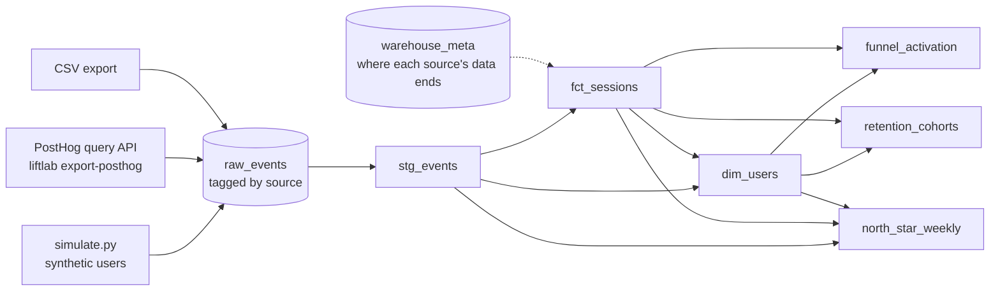

# Analytics pipeline

Events go into a DuckDB warehouse. SQL models then turn them into the North Star, the activation funnel and retention. StudySprint has almost no real traffic yet, so the numbers on this page come from a simulator with **known ground truth**, and every one of them is labelled synthetic. The definitions the SQL implements are in [METRICS.md](METRICS.md); the events are in [TRACKING_PLAN.md](TRACKING_PLAN.md).

## Running it

From `analysis/`, with [uv](https://docs.astral.sh/uv/):

```bash
uv run liftlab load --source synthetic   # simulate 20,000 users (seed 7) into data/warehouse.duckdb
uv run liftlab build                     # build the six models in analysis/sql/
uv run liftlab report                    # print the funnel, retention and North Star
```

```bash
uv run pytest                            # includes the SQL-vs-ground-truth checks
```

Simulating and loading takes about 4 seconds, and building the models about 1 second. Other sources load the same way, and loading one source replaces only that source's rows:

- `--source posthog` reads the file written by `liftlab export-posthog` (see [Real events from PostHog](#real-events-from-posthog)).
- `--source csv --path export.csv` reads any CSV with `event`, `distinct_id`, `timestamp` and `properties` (JSON) columns, plus an optional `uuid`. Add `--data-end` to say when the export ends.

To query the warehouse directly, open it with the DuckDB CLI (`duckdb data/warehouse.duckdb`) or from Python with `liftlab.warehouse.connect()`.

## Models



| Model | One row per | What it does |
|---|---|---|
| `stg_events` | event | Drops duplicate deliveries (same `uuid`), demo traffic (`is_demo`) and unplanned events, then pulls every tracking-plan property out of the JSON into a typed column. Adds the UTC date and ISO week. |
| `fct_sessions` | session | Joins each `session_started` to its first end event. Outcome is `completed`, `abandoned`, or `open` (no end event yet, and less than 24 hours old at the cutoff). A session with no end event after 24 hours is abandoned with reason `no_end_event`. |
| `dim_users` | anonymous user | First open (day 0), acquisition week, sessions started and completed, `activated_at` (first completion within 24 hours of the first open), whether that 24-hour window has closed, and the experiment arm from `experiment_exposed`. |
| `funnel_activation` | source × step | New users with 7 full days of data, through `app_opened` → `session_started` (24 h) → `session_completed` (24 h) → `second_session_7d`. Each step is a subset of the one before. |
| `retention_cohorts` | source × acquisition week | D1, D7 and D28: a session started on day n exactly. A cohort's Dn stays empty until its last member's day n has ended. |
| `north_star_weekly` | source × complete ISO week | The North Star and every input in the metric tree: WAU, sessions per active user, completion rate, new and returning users, activation rate, active days per week, streak views, weekly summary views, goal-set rate, length mix, abandon rate, p75 load time, focus minutes, concentration and event volume. |

`warehouse_meta.data_end` records where each source's data stops. Every "has this period finished?" check uses it, so nothing reports a half-finished week or cohort.

Every model keeps the `source` column (`synthetic`, `posthog` or `csv`) and groups by it, so real and synthetic numbers never mix.

## The simulator

`liftlab.simulate.simulate(n_users, seed=...)` generates users arriving over eight weeks, starting Monday 2026-08-31. Arrivals grow through the term and peak on Sundays and Mondays. Each user gets a latent **motivation**, m ~ N(0, 1), which drives four things:

- **Activation.** The chance of starting a sprint in the first 24 hours, finishing it (a first sprint is harder), and retrying the same day after giving up.
- **Session frequency.** On each later day the user is still around, the chance of a visit, with a weekday pattern (Fridays and Saturdays are quiet), and of extra sprints in that visit.
- **Completion.** Sprints with a goal are easier to finish, and 50-minute ones are harder.
- **Churn.** A daily chance of leaving for good, much higher for users who didn't activate.

Times of day follow local study hours across seven time zones, and the streak and weekly-summary properties are worked out in each user's local time, as the app does. The output looks like a PostHog export: about 358,000 events for 20,000 users, generated in about 2.5 seconds. It also includes 0.3% duplicate deliveries and 0.4% demo users, which the warehouse has to remove.

The same seed gives the same events and the same truth. The defaults are tuned to the baselines assumed in [EXPERIMENT_BACKLOG.md](EXPERIMENT_BACKLOG.md): a 50% start rate, 30% activation, 15% D7 and 75% completion.

### Ground truth

`simulate()` returns a `GroundTruth` next to the events. It's computed from the model itself, not from the sample: Gauss-Hermite quadrature over motivation, plus closed-form integrals over first-day timing (a first sprint can start after midnight UTC, which matters for D1). It holds:

- the start rate, activation rate and the retention curve D1–D28;
- the expected North Star for each week;
- the true experiment effects, in experiment mode.

A sample lands near these values, within sampling error. That's what lets the tests check the SQL:

| Metric (synthetic, seed 7, 20,000 users) | Truth | SQL | Gap |
|---|---|---|---|
| Activation rate | 30.69% | 29.95% | −0.74 pt (−2.2 SE) |
| D1 retention | 25.11% | 24.94% | −0.5 SE |
| D7 retention | 15.15% | 14.93% | −0.8 SE |
| D28 retention (cohorts with 28 days) | 8.66% | 8.28% | −1.3 SE |
| Completed sessions, all 8 weeks | 68,594 | 66,006 | −3.8% (−2.6 SE) |

Seed 7 happens to draw a slightly low sample. Its weekly completions sit between 0.3 and 3.1 standard errors under the truth, all in the same direction because the same users appear in every week. Across seeds 1 to 6, the SQL activation rate averages 30.69%, exactly the truth, and weekly completions average within 1% of it. So the gap is the draw, not a bias in the SQL.

Activation also agrees **user by user**: the set of users `dim_users` marks as activated is exactly the set the simulator activated.

The tests use the user's threshold of 1 point for activation and D7. Elsewhere they allow four standard errors, computed from the sample.

### Experiment mode

Pass an `Experiment` to simulate a test, which Day 5's statistics library is checked against:

```python
from liftlab.simulate import Experiment, simulate

sim = simulate(20_000, seed=11, experiment=Experiment(
    key="quick-start", start_day=21,
    activation_effect=0.05,   # +5 points of activation for new users in the test arm
    sessions_effect=0.2,      # +20% visits after exposure
    srm_loss=0.1,             # 10% of test exposures never logged
))
sim.truth.experiment          # start_shift, activation_control/test/effect, sessions_lift
sim.users                     # variant, exposed_at, exposure_logged, pre_sessions, motivation
```

- **Assignment.** Users are randomized 50/50 and exposed at their first visit on or after `start_day`: new users at their first open, and returning users at their first visit after the start (unless `audience="new"`).
- **Activation effect.** The simulator solves for the log-odds shift on "starts a first sprint" that makes the true activation effect exactly the number you asked for.
- **Sessions effect.** This multiplies a test user's daily visit chance after their exposure day. For returning users, expected sessions on every later day therefore scale by exactly 1 + the effect.
- **CUPED covariate.** `pre_sessions`, the number of sessions started in the 28 days before exposure, is the pre-period covariate. It's 0 for new users.
- **Sample-ratio mismatch.** `srm_loss` drops a share of test-arm exposure events. Those users still get the test experience.
- **Quick Start.** With the `quick-start` key, a new test user's first sprint has `start_method: quick_start`.

The weekly North Star truth is only computed without an experiment.

### What the model leaves out

- Time zones are fixed offsets, so there's no daylight-saving change mid-window.
- A user's activation status is fixed by day 0. Someone who first completes on day 3 keeps the low-retention profile of a non-activated user.
- A visit on the day after arrival starts at least 24 hours after the first open, so it never counts toward activation.
- There are no bots, and no ad-blocked or Do-Not-Track users. Those users send nothing in real life, so they'd be missing rather than wrong.
- The baselines are assumptions, which is the main limitation. The simulator can show that the SQL measures what it should. It can't show that real students behave like this.

## Three example questions

All results below are **synthetic**, from seed 7.

**1. Where do new users drop off on the way to activation?**

```sql
select step, users,
       round(100 * step_conversion, 1) as step_pct,
       round(100 * overall_conversion, 1) as overall_pct,
       drop_off
from funnel_activation
where source = 'synthetic'
order by step_number;
```

| step | users | step_pct | overall_pct | drop_off |
|---|---|---|---|---|
| app_opened | 16,881 | 100.0 | 100.0 | 0 |
| session_started | 8,362 | 49.5 | 49.5 | 8,519 |
| session_completed | 5,069 | 60.6 | 30.0 | 3,293 |
| second_session_7d | 4,750 | 93.7 | 28.1 | 319 |

The first step loses the most: half of new users never start a sprint. That's the step Quick Start (backlog #1) is aimed at.

**2. Do sprints with a goal get finished more often, at every length?**

```sql
select planned_minutes, goal_set, count(*) as sessions,
       round(100 * avg((outcome = 'completed')::int), 1) as completion_pct
from fct_sessions
where source = 'synthetic' and outcome <> 'open'
group by planned_minutes, goal_set
order by planned_minutes, goal_set;
```

| planned_minutes | goal_set | sessions | completion_pct |
|---|---|---|---|
| 15 | false | 8,371 | 76.4 |
| 15 | true | 8,232 | 84.1 |
| 25 | false | 24,355 | 68.4 |
| 25 | true | 25,425 | 78.9 |
| 50 | false | 10,828 | 61.8 |
| 50 | true | 12,755 | 72.7 |

Yes, by 8 to 11 points at every length. But this is a comparison, not an experiment. The more motivated users pick goals more often, so part of the gap is them rather than the goal. In the simulator, the goal's own effect is +0.35 log-odds (`Behavior.goal_bonus`), worth 6 to 8 points at these completion rates, so roughly a quarter to a third of the observed gap is selection. Real data would have the same problem, and only an experiment could separate the two.

**3. How much of D7 retention comes from users who activated?**

```sql
with eligible as (
    select u.source, u.user_id, u.acquisition_date, u.activated_at is not null as activated
    from dim_users u
    join warehouse_meta m on m.source = u.source
    where u.source = 'synthetic'
      and u.first_opened_at is not null
      and u.acquisition_date + 8 <= m.data_end::date  -- day 7 has ended
)
select
    e.activated,
    count(distinct e.user_id) as users,
    round(100 * count(distinct s.user_id) / count(distinct e.user_id), 1) as d7_pct
from eligible e
left join fct_sessions s
    on s.source = e.source and s.user_id = e.user_id
   and s.started_date = e.acquisition_date + 7
group by e.activated
order by e.activated;
```

| activated | users | d7_pct |
|---|---|---|
| false | 11,812 | 1.7 |
| true | 5,069 | 45.8 |

Activated users are 30% of new users but make up 92% of D7 returners. That's the backlog's argument for targeting activation first, and here the simulator was built on that assumption. Real data has to confirm it.

## Real events from PostHog

`liftlab export-posthog` pulls StudySprint's real events through PostHog's query API (`POST /api/projects/:id/query/` with a HogQL query). PostHog caps a query at 50,000 rows and rejects `OFFSET` for personal API keys, so the export pages by timestamp and removes duplicates by `uuid` where pages meet. It needs three things in the repo-root `.env`, which is gitignored:

```
POSTHOG_HOST=https://us.posthog.com
POSTHOG_PROJECT_ID=<project id from the PostHog URL>
POSTHOG_PERSONAL_API_KEY=<personal API key with the query:read scope>
```

The private API lives on the app host (`us.posthog.com`), not the ingestion host the front end uses. `us.i.posthog.com` is mapped to it automatically. The key is only ever sent in the Authorization header; it isn't printed, logged or written anywhere.

```bash
uv run liftlab export-posthog --since 2026-10-29
uv run liftlab load --source posthog
uv run liftlab build
uv run liftlab report --source posthog
```

The export lands in `data/raw/posthog_events.jsonl`, with a `.meta.json` file recording the time range it covers. Both are gitignored.
