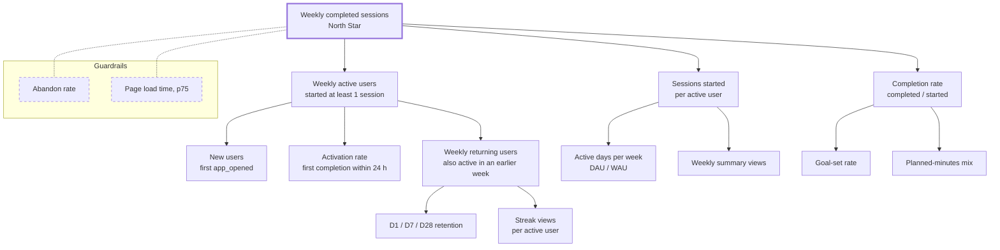

# StudySprint metrics

This file defines what we measure and exactly how. The Day 3 SQL implements these definitions as written, and the experiment readouts on Days 4–6 use them unchanged. If a definition needs to change, it changes here first.

## North Star

**Weekly completed sessions (WCS):** the number of focus sessions completed in a calendar week, Monday 00:00 to Sunday 23:59 UTC.

### How we chose it

Three candidates, each judged on three questions:

- **Value.** Does it go up only when students actually get focused study done?
- **Leading.** Does it move before retention (and, some day, revenue) does?
- **Movable.** Can a small team change it with product work in a few weeks, and does it break down into inputs that specific features own?

| Candidate | Value | Leading | Movable | Verdict |
|---|---|---|---|---|
| Weekly active users (opened the app) | ✗ Opening a tab isn't studying. Someone who opens and leaves counts the same as someone who focuses for two hours. | ~ It's close to being retention itself, so it doesn't lead it. | ✓ Easy to move, including in ways that don't help anyone, like more reminders. | Reject: vanity risk. |
| Weekly focus minutes (minutes of completed sessions) | ✓ Closest to what students care about. | ✓ | ~ Moves slowly, and the easiest way to raise it is longer sessions, which pushes completion rate down. A few heavy users dominate it. | Keep as a health metric. |
| **Weekly completed sessions** | ✓ Each one is a block of focus the student chose and finished. | ✓ Completions build streaks, and the streak is the reason to come back. Real data should confirm this: week-1 completions ought to predict D28 retention. | ✓ Splits exactly into active users × sessions per user × completion rate, and each factor has features that own it. | **Pick.** |

The decision, its trade-offs and what would make us revisit it are in [decisions/0001-north-star.md](decisions/0001-north-star.md).

## Metric tree

The first level under the North Star is an exact identity:

```
WCS = weekly active users × sessions started per active user × completion rate
```

Levels below that are drivers. They push their parent up or down, but they don't multiply out to it exactly. Guardrails (dashed) aren't targets; experiments must not make them worse.



## Ground rules

These apply to every definition below.

- **A user is one anonymous ID**: the random ID PostHog generates on the first visit and keeps in localStorage. One browser on one device is one user. The brief explains why that undercounts retention.
- **Metric time is UTC.** Days are UTC calendar days; weeks are ISO weeks starting Monday. The in-app streak uses the student's local date instead, because that's what the student sees. The two can disagree around midnight, and that's fine.
- **Only complete periods are reported.** No D7 figure for a six-day-old cohort, no WAU for a week that hasn't ended.
- **Who's missing.** Users with Do Not Track or Global Privacy Control on never send events, so they're absent rather than filtered. Traffic PostHog marks as bots is dropped.
- **Real and synthetic data never mix silently.** Warehouse rows carry `source` (`posthog` or `synthetic`), and every chart says which it shows.

## Definitions

### Acquisition and activation

| Metric | Definition |
|---|---|
| New user | A user whose first `app_opened` falls in the period. Their cohort is the UTC date of that event, called day 0. |
| Activated user | A new user who fires `session_completed` within 24 hours of their first `app_opened`. |
| Activation rate | Activated users ÷ new users, per day-0 cohort. A cohort is reported from day 2, once every member has had a full 24 hours. |
| Start rate | New users with any `session_started` within 24 hours ÷ new users. Splits activation into "started" and "finished". |
| Time to first completion | Median time from first `app_opened` to first `session_completed`, among activated users. |

Why 24 hours: it covers "opened it between lectures, did the session that evening", which is still the same study day. A longer window would mostly count people who came back, and that's retention's job.

### Engagement

| Metric | Definition |
|---|---|
| Active user | A user with at least one `session_started` in the window. Opening the app doesn't count. |
| DAU, WAU | Distinct active users per UTC day and per ISO week. WAU is "weekly active users" in the tree. |
| Weekly returning users | WAU members whose first-ever `session_started` was in an earlier week. WAU = new active users + returning users. |
| Sessions started per active user | `session_started` events in the week ÷ WAU. |
| Completion rate | Started sessions that end in `session_completed` ÷ started sessions, joined on `session_id` and counted in the week the session started. Sessions still open at the cutoff are left out. |
| Active days per week | Average DAU across the week ÷ WAU. Runs from 1/7 (everyone shows up once) to 1 (everyone shows up daily). |

### Retention

**Dn retention** is the share of a day-0 cohort with at least one `session_started` on day n exactly (UTC calendar day). We report D1, D7 and D28.

- Coming back means starting a session, not just opening the app.
- Exact day, not "day n or later". It's noisier (students skip weekends), but it's the standard form and it has the same shape as `retention_1` and `retention_7` in the Cookie Cats data analyzed on Day 6, so the two readouts compare like with like.
- The denominator is every new user, activated or not. Retention of activated users only is a useful cut, but it isn't the headline number.
- A cohort's Dn is reported once day n has fully ended.

### Guardrails

A guardrail is a metric an experiment isn't trying to move but must not hurt. Each experiment's pre-registration (Day 4) sets its own margins; these are the defaults.

| Guardrail | Definition | Default limit |
|---|---|---|
| Abandon rate | Started sessions that end in `session_abandoned`, or have no end event 24 hours after starting, ÷ started sessions. Same join and week attribution as completion rate. | Test arm no more than 2 percentage points above control. |
| Page load time | 75th percentile of `load_ms` on `app_opened`: milliseconds from navigation start until the timer controls respond. | p75 under 2,000 ms overall; test arm no more than 10% slower than control. |

Over finished sessions, abandon rate is just 1 − completion rate, so listing it separately looks redundant. It's a guardrail because experiments aimed at other inputs, like activation or sessions per user, can win by getting people to start sessions they then drop. This catches that.

### Health metrics

Watched every week, never targeted directly:

- **Weekly focus minutes**: sum of `planned_minutes` over completed sessions. That's minutes of focus; pauses aren't included.
- **Median planned minutes** of started sessions. If it slides down, people may be farming completions with short sessions.
- **Streak length distribution** among WAU.
- **Concentration**: share of WCS produced by the top 10% of users. ADR 0001 has a threshold for this.
- **Event volume** against the PostHog free tier's monthly allowance. Going over would break the $0 rule.

## Known data problems

- Identity resets (cleared storage, private windows, second devices) inflate new users and depress retention. Nothing in v1 fixes that, so trends matter more than levels.
- A session left running in a tab that's closed and never reopened sends no end event. The 24-hour rule above counts it as abandoned, with reason `no_end_event` assigned in the warehouse.
- Real traffic will be thin. Until it isn't, the numbers that drive decisions come from the Day 3 simulation, and the simulation can only reflect the assumptions it was given.
