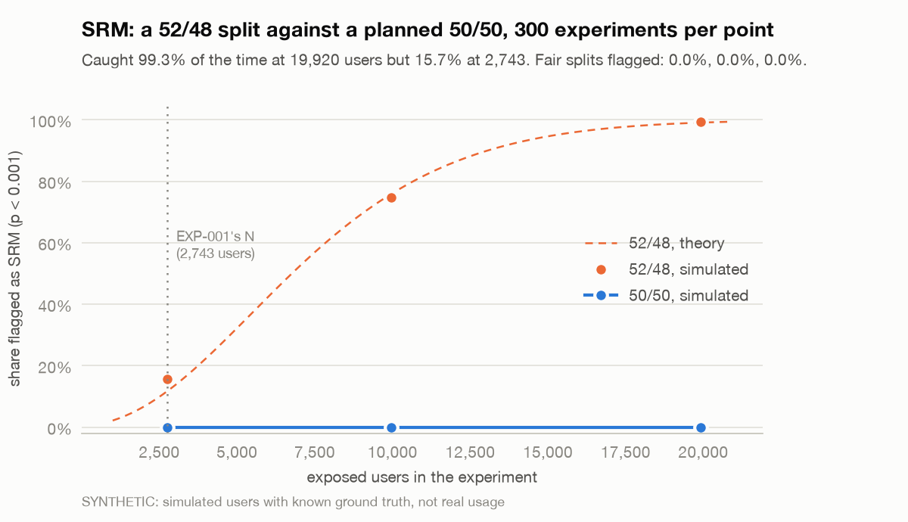
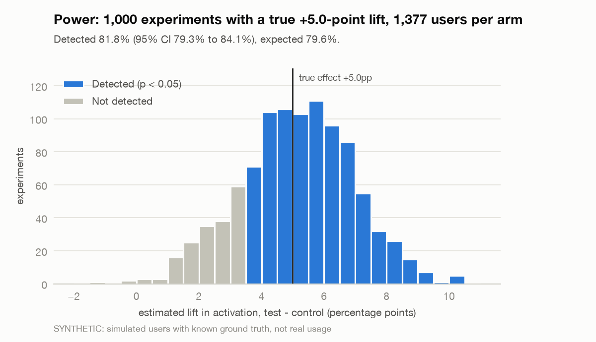

# Experiment statistics

This covers the stats library in `analysis/src/liftlab/stats/` and the readout built on it. For each method there are two plain sentences on what it does, when to use it, its formula, and what checks it. Every function is tested against scipy or statsmodels where they compute the same thing, and against a simulation property where they don't.

The simulation results come from `uv run liftlab proofs`. It generates thousands of experiments with the Day 3 simulator, loads each into an in-memory warehouse, builds `experiment_users`, and analyzes them the way the readout would. **Every number and chart from it is SYNTHETIC**: simulated users with known ground truth, not real usage. The full run took 58 minutes on an 8-core laptop that was busy with other work at the time. It writes the charts below and the numbers in [img/stats-proofs.json](img/stats-proofs.json).

| Proof (synthetic) | Result | Should be |
|---|---|---|
| A/A: 1,000 experiments with no effect, read once at 1,377 per arm | 5.8% false positives (58 of 1,000, 95% CI 4.5% to 7.4%) | 5% |
| Peeking: 1,000 A/A experiments checked every day for 28 days | z-test 27.3% (95% CI 24.6% to 30.1%); mSPRT: 1.7% (1.1% to 2.7%) | mSPRT at most 5% |
| CUPED: 1,000 A/A experiments on all users, with 28 days of pre-period | variance −22%, interval width −11%, coverage 95.6% (95.3% unadjusted) | coverage still 95% |
| SRM: 300 experiments per point, 52/48 against a planned 50/50 | 52/48 flagged in 16% at 2,743 users, 75% at 9,960 and 99% at 19,920; 50/50 flagged 0 of 300 times at each size | 12%, 76% and 99% (theory); 0.1% |
| Power: 1,000 experiments with a true +5-point lift, 1,377 per arm | 81.8% detected (95% CI 79.3% to 84.1%) | 79.6% |

- [Sample ratio mismatch](#sample-ratio-mismatch)
- [Two-proportion z-test](#two-proportion-z-test)
- [Welch t-test](#welch-t-test)
- [Delta method for ratio metrics](#delta-method-for-ratio-metrics)
- [Relative lift](#relative-lift)
- [Percentile bootstrap](#percentile-bootstrap)
- [CUPED](#cuped)
- [mSPRT](#msprt)
- [Holm correction](#holm-correction)
- [Power and sample size](#power-and-sample-size)
- [The readout and the weekly checks](#the-readout-and-the-weekly-checks)
- [What the proofs don't show](#what-the-proofs-dont-show)

## Sample ratio mismatch

`stats/srm.py`, `srm_check(counts, allocation)`

It compares how many users each arm got with how many the planned split says it should have. If the gap is too big for chance, something between assignment and logging lost users unevenly, and none of the run's metrics can be trusted.

**When:** first, on every experiment, before any metric is read. EXP-001 also runs it at every weekly check.

```
expected_i = N × planned share_i
chi² = Σ (observed_i − expected_i)² / expected_i        df = arms − 1
mismatch if p < 0.001
```

**Checked by:** a textbook value (5,100 vs 4,900 gives chi² 4.0, p 0.0455), scipy's `chisquare` with two and three arms, input errors, and the SRM proof.

<picture>
  <source media="(prefers-color-scheme: dark)" srcset="img/stats-srm-dark.png">
  
</picture>

**Synthetic result.** 300 simulated experiments at each of three sizes, assigned 52/48 against a planned 50/50. The check caught the skew in 16% of experiments at EXP-001's size (2,743 exposed users; theory 12%), 75% at 9,960 (theory 76%) and 99% at 19,920 (theory 99%). Fair 50/50 splits were flagged 0 times in 300 at every size, against an expected 0.1%. The 16% at 2,743 is 2.2 standard errors above the theory. The other two sizes match it, so that one is most likely chance.

## Two-proportion z-test

`stats/tests.py`, `ztest_proportions(x_control, n_control, x_test, n_test)`

It compares a rate per user, like activation, between the two arms. The test pools both arms' rates under the null hypothesis, and the confidence interval uses each arm's own rate.

**When:** a yes-or-no outcome per user, with at least a few dozen users and outcomes per arm. It's EXP-001's primary test.

```
p = (x_c + x_t) / (n_c + n_t)
z = (p_t − p_c) / sqrt(p (1 − p) (1/n_c + 1/n_t))           two-sided p-value from N(0, 1)
CI = (p_t − p_c) ± 1.96 × sqrt(p_c (1 − p_c) / n_c + p_t (1 − p_t) / n_t)
```

**Checked by:** statsmodels' `proportions_ztest` (z and p) and `confint_proportions_2indep` (the Wald interval), on four sets of counts from 40 to 9,645 users per arm. On 4,000 simulated A/A pairs it rejects about 5% of the time and its interval covers the truth about 95% of the time. The A/A and power proofs below run it on full simulated experiments.

<picture>
  <source media="(prefers-color-scheme: dark)" srcset="img/stats-aa-pvalues-dark.png">
  
</picture>

**Synthetic result.** 58 of 1,000 simulated A/A experiments came out significant: 5.8%, with a 95% interval of 4.5% to 7.4% that includes the 5% target. The p-values are spread across the 20 bins with between 37 and 65 in each, against 50 expected, which is about the spread chance gives. The mean estimated difference was +0.05 points. These are fresh seeds (10,001 onward); Day 4's 2,400 dry runs gave 5.6%.

## Welch t-test

`stats/tests.py`, `welch_ttest(control, test)`

It compares a mean per user, like completed sessions in 7 days, without assuming the two arms have the same variance. With thousands of users per arm it gives nearly the same answer as a z-test, and it's still right with small arms.

**When:** a count or amount per user. It's EXP-001's secondary test.

```
se = sqrt(s_c² / n_c + s_t² / n_t)
t = (ȳ_t − ȳ_c) / se
df = se⁴ / ((s_c² / n_c)² / (n_c − 1) + (s_t² / n_t)² / (n_t − 1))
CI = (ȳ_t − ȳ_c) ± t_{0.975, df} × se
```

**Checked by:** scipy's `ttest_ind(equal_var=False)`, for t, p, the degrees of freedom and the interval. Two constant arms raise an error instead of returning a p-value of 0.

## Delta method for ratio metrics

`stats/tests.py`, `ratio_metric(numerator_c, denominator_c, numerator_t, denominator_t)`

Abandon rate is abandoned sessions over ended sessions, but users were randomized, not sessions, and one user's sessions tend to go the same way. The delta method gives the variance of a ratio of per-user sums with the user as the unit, so the interval isn't falsely narrow.

**When:** any metric whose denominator isn't the number of users: a rate per session, per page view or per order. EXP-001's abandon-rate guardrail uses it.

```
per arm: R = ȳ / x̄, with y and x summed per user
Var(R) ≈ (s_y² − 2 R s_xy + R² s_x²) / (n x̄²)
diff = R_t − R_c,   CI = diff ± 1.96 × sqrt(Var(R_c) + Var(R_t))
```

**Checked by:** the linearization worked by hand, and agreement with Welch when every denominator is 1. On simulated users whose sessions share a user-level abandon rate, the delta-method interval covers the truth 95% of the time, while a naive interval that treats sessions as independent covers about 92%.

## Relative lift

`stats/tests.py`, `relative_lift(control, test, var_control, var_test)`, reported with every comparison

It's test divided by control, minus one, with a delta-method interval. The decision rule uses absolute differences, except for the page-load p75 guardrail, which is relative.

**When:** whenever a change reads better as a percentage. The control needs to be well away from zero, which every metric here is.

```
r = t / c − 1
Var(r) ≈ var_t / c² + t² var_c / c⁴
CI = r ± 1.96 × sqrt(Var(r))
```

**Checked by:** values worked by hand for the z-test, Welch and ratio comparisons.

## Percentile bootstrap

`stats/bootstrap.py`, `bootstrap_ci(statistic, *samples, n_resamples=2000, seed=None)`

It resamples users with replacement within each arm, recomputes the statistic every time, and reads the interval off the 2.5th and 97.5th percentiles. That works for statistics with no simple variance formula, like a 75th percentile.

**When:** quantiles, medians, or any statistic where a formula would be guesswork. Resample the unit that was randomized. For EXP-001's page-load p75 that's users, each carrying all of their page loads, rather than single loads.

```
repeat B times: draw n_c control users and n_t test users with replacement, compute s_b
CI = [2.5th percentile of s_b, 97.5th percentile of s_b]
```

All B resamples are drawn as one array, in batches of up to 20 million values, and the same seed gives the same interval. The readout uses B = 1,000 and seed 0.

**Checked by:** scipy's `bootstrap(method="percentile")`, within 3% of the interval's width for a mean and within 5% for a difference in p75s; resampling whole users rather than values; coverage of 95% ± 3.5 points over 300 simulated data sets.

## CUPED

`stats/cuped.py`, `cuped(outcome, treated, covariates)`

It adjusts each user's outcome by how far their behavior before the experiment was from average, which removes noise the experiment didn't cause. The covariate was fixed before assignment, so the estimate stays unbiased, and the variance falls by about the squared correlation between the covariate and the outcome.

**When:** a metric that a user's past predicts, such as a returning user's sessions. It does nothing for new users, who have no past, so EXP-001 can't use it. EXP-001 runs a regression adjustment on device type and referrer instead, as a sensitivity check that never decides anything.

```
θ = Σ (x − x̄_arm)(y − ȳ_arm) / Σ (x − x̄_arm)²          pooled within arms
y' = y − θ (x − x̄)
estimate = ȳ'_t − ȳ'_c,   variance from each arm's y' as in Welch
variance reduction = 1 − (se_adjusted / se_raw)²  ≈  corr(x, y)²
```

With several covariates, θ is a vector from the same least-squares fit, which is regression adjustment. Category columns are dummy-coded. A constant covariate gives θ = 0 and changes nothing.

**Checked by:** the estimate equals the arm coefficient in statsmodels' OLS of y on arm and x, with a standard error within 1% of the HC2 one; categorical covariates; a constant covariate; and on simulated data with correlation 0.7, an unbiased estimate, 95% coverage and a 49% variance reduction (0.7² = 0.49).

<picture>
  <source media="(prefers-color-scheme: dark)" srcset="img/stats-cuped-dark.png">
  
</picture>

**Synthetic result.** 1,000 simulated A/A experiments on all users, new and returning, whose 7-day window had closed: about 2,380 users each, with completed sessions in the 7 days after exposure as the outcome and sessions in the 28 days before it as the covariate. Across experiments the CUPED estimates varied 22% less than the unadjusted ones, close to the 21% the readouts reported, and the intervals were 11% narrower. Both still covered the true zero 95% of the time (95.6% adjusted, 95.3% unadjusted).

On returning users alone the reduction was only 8%: in the simulator, a returning user's last month predicts their next week weakly. The rest of the 22% comes from the covariate telling new users (0 sessions before) apart from returning ones. That's a property of the simulator, not a promise for real data, where a month of history usually predicts more.

## mSPRT

`stats/sequential.py`, `msprt(estimates, variances, mixing_sd=...)`, from Johari, Pekelis and Walsh, [Always Valid Inference: Continuous Monitoring of A/B Tests](https://arxiv.org/abs/1512.04922)

A fixed-horizon p-value is only valid at the one sample size it was planned for, and checking it every day until it dips under 0.05 finds false wins far more often than 5% of the time. The mixture sequential probability ratio test gives a p-value and a confidence sequence that stay valid however often you look and whenever you stop.

**When:** whenever anyone will look before the planned read: a live dashboard, an early stop, or EXP-001's weekly guardrail checks.

```
V = var_c / n_c + var_t / n_t                    at each look, from all data so far
Λ = sqrt(V / (V + γ²)) × exp(γ² (estimate − θ0)² / (2 V (V + γ²)))
p = running minimum of min(1, 1 / Λ)
CS = estimate ± sqrt(V (V + γ²) / γ² × (log((V + γ²) / V) − 2 log α)),  intersected over looks
```

**The mixing parameter γ.** It's the standard deviation of the normal mixture over effects, and it sets which effect size the test finds fastest. The paper's equation 12 gives the best γ for effects drawn from N(0, τ²) when the test runs to at most M users per arm:

```
γ² = τ² × Φ(−b) / (φ(b) / b − Φ(−b)),     b = sqrt(2 log(1/α) / (M τ²))
```

with τ in units of one user's standard deviation. For EXP-001's primary metric, τ is the MDE (5 points, or 0.077 in units of sqrt(2 × 0.3 × 0.7)) and M is the planned 1,377 per arm, which gives **γ = 0.0620**. In other words, we expect effects about the size we planned to detect, by the time we planned to read. The paper finds the test is robust to γ being off by up to a factor of 10. For the weekly guardrail checks, γ is each guardrail's threshold (Amendment 1 in EXP-001.md).

**Checked by:** Λ worked by hand and against numerical integration of the mixture; the confidence sequence's edges sitting exactly where Λ = 1/α; p-values that never rise and intervals that only shrink; equation 12 worked by hand; and 2,000 simulated normal paths with 500 looks each, where the mSPRT stays under 5% and the naive test passes 25%. Rejecting at α = 0.05 needs |z| ≥ 3.04 for any γ, so an mSPRT rejection is always a fixed-horizon rejection too.

<picture>
  <source media="(prefers-color-scheme: dark)" srcset="img/stats-peeking-dark.png">
  
</picture>

**Synthetic result.** 1,000 simulated A/A experiments of new users, about 1,366 per arm by the last look, each checked once a day for 28 days. Stopping at the first p < 0.05 from the fixed-horizon z-test declared a win in 27.3% of them (95% CI 24.6% to 30.1%), more than five times the nominal rate. The same test read once, on the last day, was wrong 4.9% of the time. The mSPRT with γ = 0.0620 stopped in 1.7% (1.1% to 2.7%). It sits under 5% because its guarantee has to hold however many looks there are, so with 28 looks it has room to spare. Nothing stopped in the first week, while there were few users.

## Holm correction

`stats/multiple.py`, `holm(p_values, alpha=0.05)`

Testing several secondary metrics at 5% each gives well over a 5% chance that at least one comes up by luck. Holm's step-down method adjusts the p-values so that chance stays at 5%, and it's never less powerful than Bonferroni.

**When:** a family of secondary metrics. EXP-001 has one secondary today, so Holm changes nothing yet, but the readout applies it so a second metric can't be added without it.

```
sort the m p-values: p_(1) ≤ … ≤ p_(m)
adjusted p_(i) = max over j ≤ i of min(1, (m − j + 1) × p_(j))
reject where adjusted p ≤ α
```

**Checked by:** statsmodels' `multipletests(method="holm")`, and 10,000 simulated families of four true nulls, where Holm makes any false rejection at most 5% of the time and unadjusted tests about 18.5% (1 − 0.95⁴).

## Power and sample size

`stats/power.py` (Day 4), `sample_size_proportions`, `power_proportions` and the same for means

It works out how many users per arm a test needs to detect a given effect with a given probability, or what effect a given sample can detect. EXP-001 needs 1,377 users per arm for a 5-point lift on a 30% baseline at 80% power.

**When:** before the experiment, to set N, and never after the data is in.

```
n per arm = (z_{1−α/2} sqrt(2 p̄ (1 − p̄)) + z_{1−β} sqrt(p_c (1 − p_c) + p_t (1 − p_t)))² / (p_t − p_c)²
p̄ = (p_c + p_t) / 2
```

**Checked by:** statsmodels' `power_proportions_2indep`, `NormalIndPower` and `TTestIndPower`, one- and two-sided, absolute and relative; and the power proof.

<picture>
  <source media="(prefers-color-scheme: dark)" srcset="img/stats-power-dark.png">
  
</picture>

**Synthetic result.** 1,000 simulated experiments with a true +5.0-point lift, each read at 1,377 users per arm with the pre-registered z-test. 818 detected it: 81.8% (95% CI 79.3% to 84.1%), against the 79.6% expected at the simulator's true control rate of 30.7%. The mean estimated lift was +5.14 points. The runs that missed are the ones whose estimate landed under about +3.5 points, and that's the price of 80% power: one experiment in five with a real 5-point lift looks like nothing.

## The readout and the weekly checks

`liftlab/readout.py` runs a pre-registered plan from its YAML copy ([EXP-001.yaml](experiments/EXP-001.yaml)): SRM, then the primary (and its adjusted estimate), the guardrails, the secondaries with Holm, and the decision rule top to bottom. The first rule whose conditions all hold decides SHIP, ITERATE or KILL, or INVALID and UNDERPOWERED, which make no decision. The reasons list every rule checked on the way. Output is Markdown or JSON, labeled SYNTHETIC when the data is.

```bash
cd analysis && uv run liftlab readout --source posthog            # or --format json --out readout.json
```

`liftlab/monitor.py` runs EXP-001's weekly checks: SRM on everyone exposed so far, and an mSPRT confidence sequence for each guardrail. The run stops early only for an SRM failure or a guardrail whose always-valid interval lies entirely past its threshold.

```bash
cd analysis && uv run liftlab monitor --source posthog
```

`tests/test_readout.py` drives every branch of the decision rule with synthetic data built to land on it, and checks `experiment_users` against the simulator's truth. `tests/test_monitor.py` does the same for the weekly checks.

## What the proofs don't show

- The simulator's users follow the assumptions in [ANALYTICS.md](ANALYTICS.md). Real metrics can have heavier tails, novelty effects and weekly cycles, which these simulations don't have. The library's first real data is the public Cookie Cats A/B test, read in [EXP-000](experiments/EXP-000-memo.md): its game rounds have a far heavier tail than anything simulated here, with one player at 49,854 rounds.
- The mSPRT on binary data uses plug-in variances, which the paper calls approximately valid. The peeking proof shows it holding at EXP-001's size and baseline, not everywhere.
- The SRM check is weak at EXP-001's size. At 2,754 users it catches a 52/48 split only about 12% of the time, and catching it 80% of the time takes about 10,700 users. At 2,754 users it's reliable (80%) only for skews of about 54/46 or worse, and in the live run, at about 140 users per arm, only for about 62/38 or worse.
