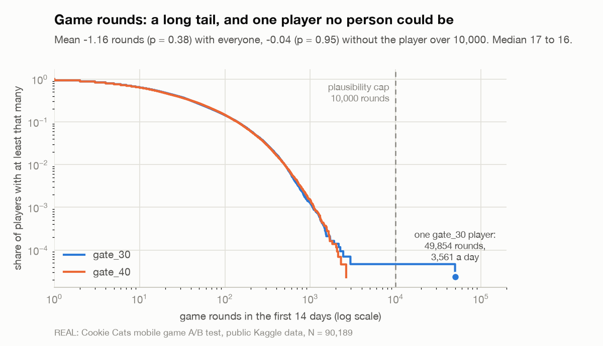

# EXP-000 decision memo: keep the first gate at level 30

**Every number here is REAL**: the public Cookie Cats A/B test, 90,189 players, read with `liftlab cookie-cats` against the plan in [EXP-000-cookie-cats.md](EXP-000-cookie-cats.md). The full readout is [EXP-000-readout.md](EXP-000-readout.md).

**Recommendation: keep the gate at level 30.** 7-day retention was 18.20% with the gate at level 40 vs 19.02% at level 30 (Δ −0.82pp, 95% CI [−1.33, −0.31]); SRM check passed (p = 0.0086).

The decision rule's answer is KILL, which for this test means the game stays as it shipped. Rules 1 to 5 didn't match: no SRM, both arms past the 24,641 players they needed, the guardrail held, and the primary's interval sits entirely below zero, so neither SHIP nor ITERATE applies.

## Evidence

| Metric | gate_30 | gate_40 | gate_40 − gate_30 (95% CI) | p |
|---|---|---|---|---|
| **7-day retention** (primary) | 19.02% | 18.20% | **−0.82pp** [−1.33, −0.31]; bootstrap [−1.35, −0.32] | 0.0016 |
| 1-day retention | 44.82% | 44.23% | −0.59pp [−1.24, +0.06]; bootstrap [−1.25, +0.06] | 0.074 (Holm 0.15) |
| Game rounds, mean | 52.46 | 51.30 | −1.16 [−3.72, +1.40] | 0.38 (Holm 0.38) |
| Game rounds, median | 17 | 16 | −1 [−1, 0], bootstrap | |
| Never played a round (guardrail) | 4.33% | 4.52% | +0.19pp [−0.08, +0.46], limit +1.0 | |
| Players | 44,700 | 45,489 | SRM p = 0.0086, threshold 0.001 | |

- **The primary moved the wrong way and the interval excludes zero.** Relative to level 30, that's 4.3% fewer players still playing a week after install (95% CI 1.7% to 6.9%). The bootstrap of 2,000 player resamples gives nearly the same interval as the z-test, as it should with 45,000 players per arm.
- **The secondaries point the same way but prove nothing on their own.** 1-day retention is 0.59 points lower, not significant after Holm. Game rounds barely differ: the median player played one round fewer, and the means are within noise.
- **The guardrail held.** The share of players who never played a round differs by 0.19 points, inside its +1.0 limit, which suggests the `gate_40` build didn't break anything before the first gate.

### The outlier

One `gate_30` player recorded **49,854 game rounds** in 14 days: 3,561 a day, or a round every 24 seconds around the clock for two weeks. The next-highest player has 2,961. They didn't come back on day 1 but did on day 7. No person plays like that; it's a logging fault, a bot or a test device, and the data can't say which.

They stay in the analysis of record, as the plan says. Dropping them moves the game-rounds difference from −1.16 (p = 0.38) to −0.04 (p = 0.95), so this one row makes up nearly all of the gap between the arms' means. It changes no conclusion: game rounds is a secondary and wasn't significant either way. The primary and the decision can't be moved by it, since this player counts as one 7-day "yes" among 44,700.

### No CUPED

There's no pre-experiment behavior to adjust with: players were randomized at install. Game rounds and 1-day retention happen after assignment and can be moved by the gate, so using them as covariates would bias the estimate. With no pre-assignment attributes in the file, the readout is unadjusted. That costs little here, since the primary's interval already excludes zero.

## Risks

- **This was written after the result was known.** The pre-registration is retrospective, and I knew the usual conclusion from this dataset before opening it. The tests, the SRM threshold and the rule shape were set for EXP-001 before this data existed, but the MDE, the guardrail and the outlier cap were set after seeing it. Only the MDE could have changed the answer: below 0.75 points, rule 2 would have needed more players than the smaller arm has, and the readout would have said UNDERPOWERED instead of KILL.
- **The split is a little uneven.** `gate_40` has 789 more players, 50.44% of the total. That passes the 0.001 threshold (p = 0.0086) but would fail at 0.01. If those extra players differ systematically (say, a logging difference between builds), part of the gap could be an artifact. The assignment logs would settle it; the CSV can't.
- **Most players never reach either gate.** The file doesn't record the level reached, so this is intent to treat over everyone who installed. The effect on players who actually hit level 30 is larger than −0.82 points, by an unknown amount.
- **Retention isn't revenue.** The gate is also where players pay to skip the wait. Moving it to 40 might change purchases in either direction, and the data has no revenue, so this memo can't weigh the two.
- **It's one test, run years ago** (the file is dated 2019). The game and its players may have changed since, so the size of the effect may not hold today.

## What to test next

1. **The same comparison, instrumented.** Log the level reached and purchases, so the effect can be measured on players who reach the gate and revenue per player can be a guardrail. At a 19% baseline, detecting a 0.75-point change takes 43,593 players per arm.
2. **An earlier gate, at level 20 or 25.** If the forced break is what keeps players around, an earlier one might help. That's a hypothesis from this result, not something this data shows. Pre-register it with 7-day retention as primary and 30-day retention and revenue per player as guardrails.
3. **Longer retention.** 7 days is short for a puzzle game. Track 30-day retention in the next test, since an early break might pay off later or wear off.

## What this means for LiftLab

The readout library, built and checked on simulated data, produced the dataset's published result on real data, with the decision traced through the same rules EXP-001 will use.

*REAL: Cookie Cats mobile game A/B test, public Kaggle data, N = 90,189*
